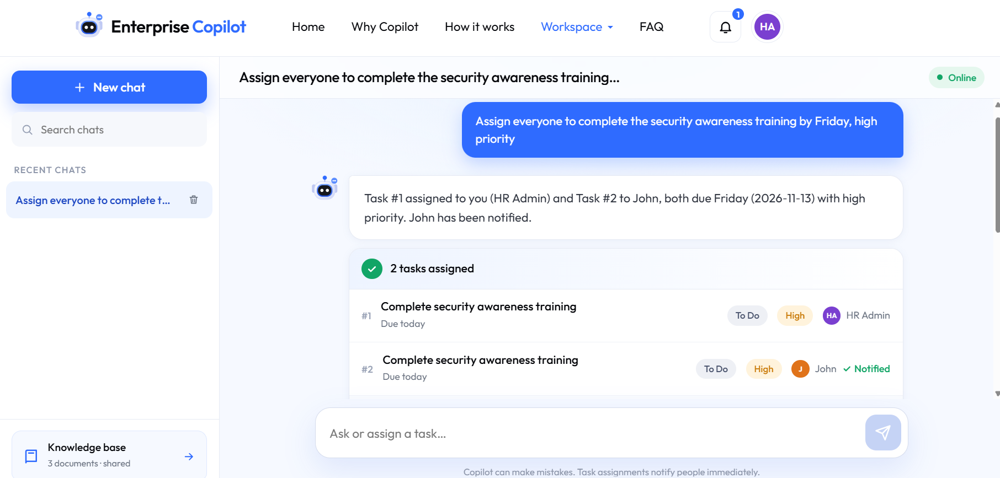
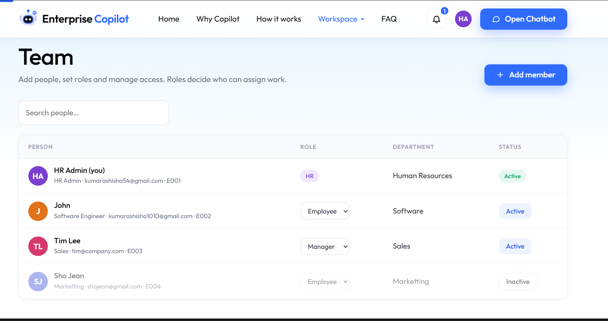
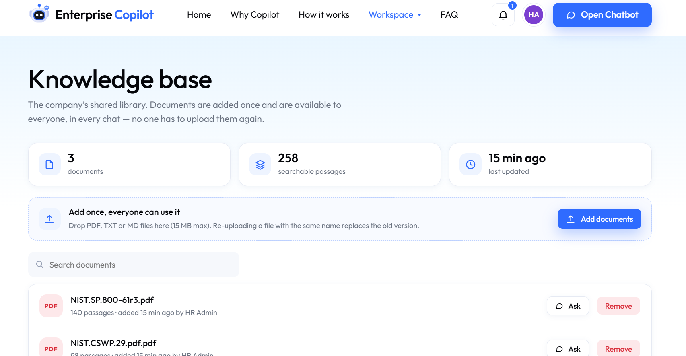

# Enterprise Knowledge Copilot

An AI assistant for company knowledge and task coordination. Ask questions about shared company
documents, assign work in chat, and notify teammates when tasks change.

Built with **FastAPI**, **LangGraph**, **MCP**, and **PostgreSQL + pgvector**. The frontend is plain
HTML, CSS, and JavaScript and is served by the application.

## Screenshots

<details>
<summary>View the chatbot, team management, and knowledge base</summary>







</details>

## Features

- **Chat-based task management:** assign tasks to people, departments, or the whole company.
- **Company knowledge base:** upload PDF, TXT, and Markdown files for shared, source-grounded answers.
- **Role-based access:** HR, managers, and employees have different task and team permissions.
- **Task board and notifications:** track task status in the UI; receive in-app notifications and
  optional email updates and reminders.
- **Private chat history:** conversations are scoped to the signed-in user.

## Quick start

### Docker Compose

1. Copy `.env.example` to `.env`.
   - PowerShell: `Copy-Item .env.example .env`
   - macOS/Linux: `cp .env.example .env`
2. Set `GROQ_API_KEY`, `SECRET_KEY`, `ADMIN_EMAIL`, and `ADMIN_PASSWORD` in `.env`.
3. Start the app:

   ```sh
   docker compose up --build
   ```

4. Open <http://localhost:8000>. Interactive API documentation is at <http://localhost:8000/docs>.

Compose starts PostgreSQL with pgvector and the web application. If host port `5432` is already
in use, remove the `db` service's `ports` mapping in `docker-compose.yml` (the app can reach the
database over Compose's internal network), or change the host side of the mapping, for example to
`5433:5432`.

### Local Python

Requires Python 3.11+ and PostgreSQL with the pgvector extension.

```powershell
py -m venv .venv
.\.venv\Scripts\Activate.ps1
pip install -r requirements.txt
Copy-Item .env.example .env
# Configure GROQ_API_KEY, DATABASE_URL, SECRET_KEY, ADMIN_EMAIL, and ADMIN_PASSWORD in .env.
uvicorn app.main:app --reload
```

For macOS/Linux, activate the environment with `source .venv/bin/activate` and copy the
configuration with `cp .env.example .env`.

## Accounts and access

- Configure `ADMIN_EMAIL` and `ADMIN_PASSWORD` to create or refresh the HR administrator on startup.
- Self-registration creates employee accounts only. Set `ALLOW_SIGNUP=false` to make account creation
  HR-managed.
- Demo-user seeding is disabled by default. Keep `SEED_DEMO_USERS=false` outside private demos.
- HR can add team members and deactivate accounts from the **Team** page. Existing demo users in a
  database are not removed automatically.

New team members need an initial password. The app does not currently send invitations or provide a
password-reset flow.

## Email notifications

Email is optional and is used for task assignments, task updates, and due-date reminders—not account
invitations. Configure the following values in `.env`:

```dotenv
SMTP_HOST=smtp.gmail.com
SMTP_PORT=587
SMTP_USER=your-sender@gmail.com
SMTP_PASSWORD=your-provider-app-password
SMTP_FROM=your-sender@gmail.com
APP_PUBLIC_URL=https://your-app.example.com
```

Port `587` uses STARTTLS. For Gmail, use an App Password rather than your regular account password.
Restart/recreate the app after changing environment settings. Keep `.env` private and never commit
real credentials.

## Configuration

See [`.env.example`](.env.example) for available settings. Set a stable, private `SECRET_KEY` in any
non-local deployment. The app needs a Groq API key; `DATABASE_URL` is required when running outside
Docker Compose. Optional email delivery requires SMTP settings.

## Tests

Run the unit tests with:

```sh
pytest
```

Database tests require `TEST_DATABASE_URL` to point to a disposable PostgreSQL database with
pgvector enabled. Do not point test runs at your production or regular development database.

## Project structure

| Directory | Purpose |
|---|---|
| `app/` | FastAPI application, configuration, authentication, and API routes |
| `db/` | PostgreSQL models and repositories |
| `graph/` | LangGraph workflow and state |
| `mcp_server/` | MCP task and employee tools |
| `ingestion/` | Document loading and embedding |
| `frontend/` | Web application |
| `tests/` | Unit and database tests |

## 👨‍💻 Contributors
- [@ash-iiiiish](https://github.com/ash-iiiiish)


## 🤝 Contributing
Contributions are welcome! Fork this repository and submit a pull request.


---

## 📄 License

This project is licensed under the MIT License — see the [LICENSE](LICENSE) file for details.............

---